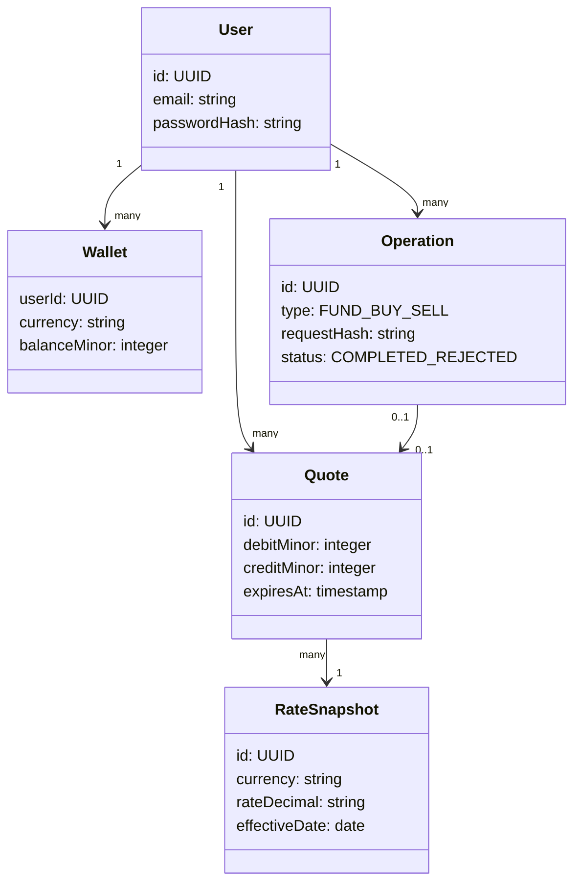
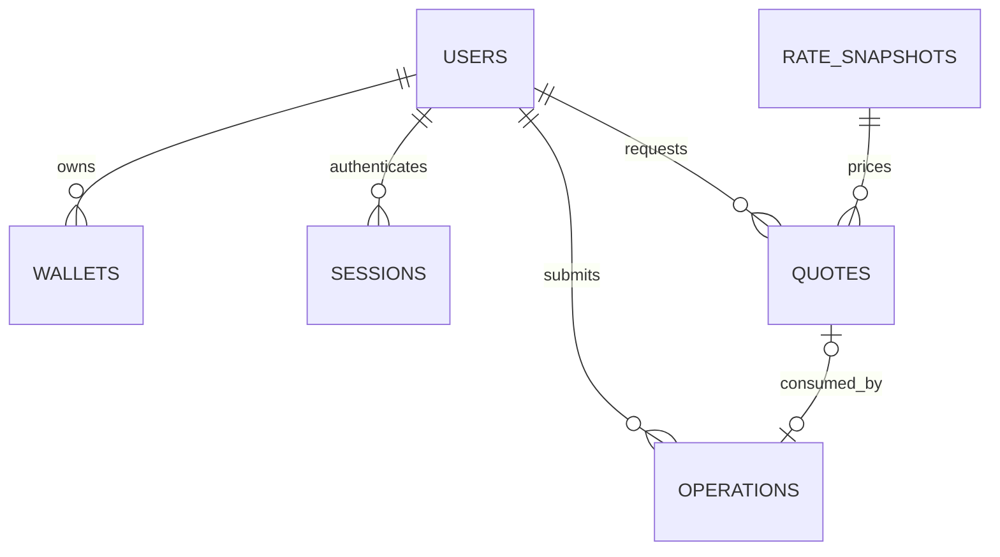

# Mobile Currency Exchange System
## Part 1 — Conceptual Design / M1 working draft

Status: proposed design, not an implementation or submission-ready report. Prepared 4 November 2026. Covers laboratory weeks 1–4 using the supplied template headings. The remaining handbook requirements must be checked before submission. The GitHub repository is initialized and the author reports updating the README. Implementation and fault tests are planned.

## 1. General Information

| Field | Value |
|---|---|
| Project | Mobile Currency Exchange System |
| Author | Murat Aydın — individual project |
| Subject | Network Issues in Mobile Systems |
| Field of study | Information Technology |
| Year / semester | To confirm |
| Supervisor | To confirm from course information |
| Group number | To complete after Moodle selection |
| Student number | To confirm |
| Submission date | To confirm from M1 submission activity |
| Git repository | https://github.com/Murataydin11/mobile-currency-exchange |
| M1 revision | Record the commit containing the M1 design files |

## 2. Project Description

### 2.1 Project Objective

The project aims to deliver an integrated mobile application for simulated currency exchange. A user can register, sign in, add virtual PLN funds, browse current and historical NBP exchange-rate data, buy and sell supported currencies, and review wallet balances and transaction history. The main engineering objective is to preserve understandable and consistent behaviour during disconnection, delayed replies, repeated requests and response loss. All funding and exchange actions are simulations; the system does not move real money.

### 2.2 Project Scope

Proposed stack: React Native with Expo and TypeScript for the mobile client; Node.js, Express and TypeScript for the service; SQLite for persistent storage. These are design choices, not instructor-mandated technologies. Exact dependency versions will be recorded when the repository is initialized.

The client presents data, stores a limited cache and tracks uncertain operations. The service authenticates users, authorises access, obtains NBP data, validates changes and determines authoritative outcomes. The database stores users, sessions, currency wallets, rate snapshots, quotes and operations. NBP integration details and supported currencies remain to be verified against official documentation and the full handbook.

Proposed initial currencies: PLN, EUR and USD, subject to the full functional requirements. Real payments, speculative trading, social features and production deployment are outside the initial scope.

## 3. System Requirements

### 3.1 Functional Requirements

| ID | Function | Expected behaviour | Priority |
|---|---|---|---|
| F1 | Registration | Create an account with a unique normalised email and securely hashed password. | High |
| F2 | Login/logout | Authenticate and end a service-controlled session. | High |
| F3 | Simulated funding | Add a positive virtual PLN amount; label it simulated. | High |
| F4 | Current rates | Show supported NBP rates with source, effective date and retrieval time. | High |
| F5 | Historical rates | Retrieve rates for a selected supported currency and date range. | High |
| F6 | Buy currency | Exchange PLN for foreign currency using an explicit server quote. | High |
| F7 | Sell currency | Exchange foreign currency for PLN using an explicit server quote. | High |
| F8 | Wallets | Show authoritative balances with last successful refresh time. | High |
| F9 | History | List the authenticated user's completed funding and exchange operations. | High |
| F10 | Recovery | Resolve a submitted operation by its stable identity after response loss. | High |
| F11 | Cached reads | Show cached rates, balances and history with an explicit stale/offline label. | High |

### 3.2 Non-Functional Requirements and Invariants

| ID | Requirement | Acceptance criterion |
|---|---|---|
| N1 | Atomicity | A successful exchange commits its debit, credit and operation record together; rollback leaves all unchanged. |
| N2 | Duplicate protection | Replaying one operation identity and payload never creates a second money movement. |
| N3 | Balance consistency | Concurrent requests cannot produce a negative wallet balance. |
| N4 | Authorisation | A user cannot read or mutate another user's wallets or operations. |
| N5 | Honest state display | A timeout after submission produces an unknown/pending state, not a claim of failure or success. |
| N6 | Freshness | Cached information includes its timestamp; refresh failures do not make it appear current. |
| N7 | Reproducibility | README documents prerequisites, configuration, database initialization and mobile/service startup. |
| N8 | Observability | Operation IDs connect client state, API logs and persistent outcomes; secrets are excluded from logs. |
| N9 | Credential handling | Passwords are hashed; session credentials use platform-appropriate protected storage; deployed traffic uses HTTPS. |

Numerical performance targets will be defined with a named test environment; the sample template's two-second response time is not assumed to be a mandatory course rule.

### 3.3 Network Scenario Matrix

Policy: cached reads are allowed; offline mutations are blocked. A request already submitted may have an unknown result and must be reconciled. The service remains the authority even if the operating system reports network connectivity.

| ID | Scenario | Client-visible behaviour | Server/database outcome | Planned verification |
|---|---|---|---|---|
| S1 | Connection lost before sending | Block mutation; retain form input. | No operation received. | Disable service access before submission; balances unchanged. |
| S2 | Request lost in transit | Show unknown outcome after timeout; retain identity. | No record if request never arrived. | Drop outbound request; lookup, then replay same identity. |
| S3 | Commit succeeds, response lost | Show checking/pending; never infer failure. | Exactly one committed operation. | Drop response after commit, recover by identity, count one movement. |
| S4 | Response is delayed | Keep operation pending; prevent a new identity for the same intent. | May still be processing or completed. | Delay response and verify no duplicate submission. |
| S5 | User retries an operation | Replay the stored payload with the same identity. | Return original final result if completed. | Send identical request twice; compare outcome and balances. |
| S6 | Same identity, different payload | Show conflict; do not silently submit as a new action. | Reject conflicting payload; no extra movement. | Change amount on replay; expect conflict. |
| S7 | Read while offline | Show cache and timestamp, or unavailable if no cache exists. | No new authoritative read. | Open with and without populated cache. |
| S8 | Reconnection | Resolve uncertain mutations, then refresh wallets/history/rates. | Query stored results or safely replay unknown requests. | Restore access after S3; UI converges to database. |
| S9 | Two exchanges compete for funds | Show completed/rejected results separately. | At most affordable operations succeed; no negative balance. | Submit parallel requests whose total exceeds funds. |
| S10 | NBP is unavailable | Show old data as stale; block new quotes under the initial policy. | Existing wallets unchanged. | Force upstream failure and attempt new quote. |
| S11 | Session expires during recovery | Request login; preserve pending identity for the same account. | No unauthorised access. | Expire session after submission and recover after login. |
| S12 | App closes after sending | On restart, recover the persisted pending operation. | Original result remains authoritative. | Close app after send and reopen. |
| S13 | Late response arrives after recovery | Merge by operation identity; do not apply balance deltas twice. | No new operation. | Deliver original delayed response after successful lookup. |

## 4. UML Models

### 4.1 Use Cases

Actors: mobile user and external NBP data provider. The service is inside the system boundary, not a human actor. No administrator interface is added to Project A unless the remaining handbook requires one.

| Use case | Preconditions | Main flow | Alternative outcome |
|---|---|---|---|
| Register/sign in | Service reachable | Validate credentials; create account or session. | Validation error, duplicate account or unavailable service. |
| Browse rates/history | Valid session for private data | Read service data and refresh cache. | Cached labelled view or explicit unavailable state. |
| Add simulated funds | Valid session and positive permitted amount | Persist operation identity; submit; service atomically credits PLN wallet and records result. | Rejection or unknown outcome requiring recovery. |
| Buy/sell | Valid session, quote and sufficient funds | Obtain quote, confirm, persist identity, submit and show authoritative result. | Expired quote, insufficient funds, conflict or unknown outcome. |
| Recover operation | Persisted identity and same authenticated account | Lookup; display final result or safely replay original request. | Not found is not proof that an in-flight request cannot still arrive. |

Formal use case diagram to be rendered for the final Word/PDF report; this table defines its content.

### 4.2 Class Diagram

Application responsibilities: AuthService manages sessions; RateService obtains and caches NBP data; QuoteService fixes proposed exchange terms; ExchangeService validates and atomically records mutations; OperationRepository provides outcome lookup; SyncCoordinator reconciles client pending operations.

## 5. Database Design

SQLite types below describe a proposed schema. UUIDs and UTC ISO timestamps use TEXT. Wallet balances and amounts use INTEGER minor units; calculations use decimal arithmetic with explicit rounding, not binary floating-point balances.

| Table | Keys and essential fields | Constraints |
|---|---|---|
| users | id TEXT PK; email TEXT; password_hash TEXT; created_at TEXT | Unique normalised email; required fields NOT NULL. |
| sessions | token_hash TEXT PK; user_id TEXT FK; expires_at TEXT | Never store raw bearer tokens. |
| wallets | user_id TEXT FK + currency TEXT composite PK; balance_minor INTEGER | balance_minor >= 0; supported currency only. |
| rate_snapshots | id TEXT PK; currency TEXT; rate_decimal TEXT; effective_date TEXT; fetched_at TEXT; source_ref TEXT | Retain the source/date used by a quote. |
| quotes | id TEXT PK; user_id TEXT FK; rate_snapshot_id TEXT FK; side TEXT; foreign_currency TEXT; debit_currency TEXT; debit_minor INTEGER; credit_currency TEXT; credit_minor INTEGER; expires_at TEXT | Positive amounts; owned by one user; one successful consumption. |
| operations | id TEXT PK; user_id TEXT FK; type TEXT; request_hash TEXT; quote_id TEXT nullable FK; status TEXT; result_json TEXT; created_at TEXT | Immutable terminal result; unique non-null quote_id prevents quote reuse. |

operations is the transaction-history source. Rejected business operations keep an auditable terminal result but do not change wallets. An internal failure before a durable outcome rolls back the transaction; retry is then allowed with the original identity. Database foreign-key enforcement must be enabled.

Proposed exchange semantics: foreign amount is a positive amount with at most two decimal places. A quote states exactly which wallet is debited, which is credited, the fixed amounts and rate date. The initial simulator applies one documented NBP reference rate with no fees/spread; this policy needs checking against the remaining brief. Calculate the PLN amount once with decimal arithmetic and round half-up to PLN minor units. Do not recompute it on retries. Quotes expire after a proposed 60 seconds. A successful duplicate returns the stored result even after quote expiry.

## 6. System Architecture

The mobile client calls the service over HTTP(S). Only the service accesses SQLite and NBP. The client cache is a display aid, never an authority for available funds. The service can retain previously obtained rate snapshots; new trades follow the explicit quote/freshness policy.

Data flow for a trade: user enters amount → client requests quote → service validates and fixes amounts → user confirms → client durably stores operation identity and payload before sending → service processes atomically → client displays terminal result and refreshes wallets/history. If response delivery fails, recovery uses the same identity.

### Lab 1 user journeys and data ownership

| Journey | Request path | Expected outcome |
|---|---|---|
| Normal read | Phone → Wi-Fi or cellular link → API → NBP | The phone displays the rate, its effective date and the fetch time. |
| Normal buy | Phone → wireless link → API → SQLite | The service commits both wallet changes and the operation record together, then confirms the result. |
| Connection lost before funding | Phone detects that the service is unreachable before sending | The app retains the form and blocks submission. The server balance stays unchanged. |
| Connection lost after a buy commits | SQLite commits, but the reply fails on the wireless path | The phone shows an unknown outcome. After reconnection it looks up the original operation ID and refreshes both wallets. |

NBP publishes the reference rates. SQLite holds the authoritative balances and outcomes, and the API validates and commits changes. The phone owns its display cache and pending operation IDs.

### 6.1 API Contract — Proposed Application API

These are our own endpoint designs, not statements about the external NBP API.

| Method/path | Request | Success | Main errors |
|---|---|---|---|
| POST /auth/register | email, password | 201 user id | 400 invalid; 409 duplicate |
| POST /auth/login | email, password | 200 session token, expiry | 401 invalid credentials |
| POST /auth/logout | bearer token | 204 | 401 |
| GET /rates/current | optional currency filter | 200 rates with source/effective/fetched times | 503 unavailable |
| GET /rates/history | currency, from, to | 200 dated rate entries | 400 invalid range; 503 |
| GET /wallets | authenticated request | 200 balances, asOf | 401 |
| GET /transactions | cursor, limit | 200 terminal history, nextCursor | 401; 400 |
| POST /quotes | side BUY/SELL, foreignCurrency, foreignAmount string | 201 quote id, debit/credit amounts, expiry, rate date | 400; 401; 503 |
| POST /funding | operationId UUID, amountMinor integer | 200 operation result | 400; 401; 409 |
| POST /exchanges | operationId UUID, quoteId | 200 operation result | 400; 401; 409 |
| GET /operations/{id} | authenticated request | 200 terminal outcome | 401; 404 absent or not owned |

Terminal operation result: operationId, status (COMPLETED or REJECTED), reasonCode where applicable, simulated=true, debit/credit amounts if applicable, completedAt. Business rejection is returned as a recorded terminal result; malformed input/authentication failures use HTTP errors. Payload mismatch or quote ownership/consumption conflict uses 409. Error body: code, message and operationId where available. Response dates must distinguish rate effective date, fetch time and operation completion time.

### 6.2 Stable Identity and Recovery

1. The client generates a UUID per confirmed intent and persists the identity and canonical payload before dispatch.
2. The service authenticates first. Within a database write transaction it looks up that ID; another user's ID is not disclosed.
3. Same user + same canonical payload returns the stored terminal result. Same ID with a different payload is a conflict.
4. For a new exchange, validate quote ownership, expiry, unused state and available funds. Atomically debit/credit wallets and insert the terminal operation record. Funding uses the same protection.
5. Balance checks and updates occur under the same write transaction; transient database contention is retriable with the same identity.
6. After a timeout the client marks its local operation UNKNOWN. On reconnect it authenticates, queries the outcome and, if absent, may replay the original payload and ID. It does not invent a second identity.
7. Persist terminal outcomes for the project lifetime. Keep UNKNOWN client records until resolved; account switching must not replay an old account's work.

Client states: READY → locally persisted PENDING → COMPLETED/REJECTED, or UNKNOWN after loss of delivery. UNKNOWN can transition to a recovered terminal result or back to pending through safe replay. An HTTP timeout alone is never a business rejection.

## 7. Project Implementation Plan

| Stage | Work | Completion evidence | Responsible |
|---|---|---|---|
| Lab 1 | Select topic, initialize Git, document stack and architecture. | Actual repository URL, initial README, architecture and risk notes. | Murat Aydın |
| Lab 2 | Requirements and network scenarios. | F/N requirements and S1–S13 matrix reviewed against full handbook. | Murat Aydın |
| Lab 3 | Actors, use cases, classes and flows. | Rendered UML and flow explanations. | Murat Aydın |
| Lab 4 / M1 | ERD, types, keys, API contract and recovery design. | Completed template exported to PDF; actual repository link. | Murat Aydın |
| Following prototype stage | Service/database/auth, NBP adapter and mobile screens. | Reproducible integrated app; milestone date to confirm. | Murat Aydın |
| Resilience/final stage | Fault injection, recovery, consistency and defence. | Recorded actual results for network scenarios and final demonstration. | Murat Aydın |

Proposed repository structure: mobile/, server/, docs/, README.md, .gitignore and .env.example. The repository currently serves as the starting point for the project. The listed directories are planned.

Initial risks: uncertain outcomes after response loss; double application on retry; stale rate display; concurrent overspending; session expiry during recovery; local cache leakage between accounts. Mitigations are mapped above. Exact due dates must be copied from Moodle, not inferred from recording dates.

## 8. Conclusions and Possible Extensions

The design separates display freshness, request delivery and authoritative execution. Its central invariant is that one operation identity produces at most one wallet change, even when responses are delayed or lost. Potential extensions after the required project: more currencies, charts and richer filters. Offline transaction queues are deliberately excluded from the initial design to keep pricing and confirmation rules clear.

### Before M1 submission

- Review all remaining handbook sections and M1 evidence requirements.
- Confirm year/semester, student number, supervisor, group and exact due date.
- Commit the M1 design files and record the resulting revision.
- Verify NBP documentation, rate selection, supported currencies and historical query constraints.
- Render a formal use case diagram and readable class/ER diagrams in the final report.
- Transfer the reviewed text into the supplied Word template and export/inspect PDF.
- Do not present proposed fault tests as completed tests or this draft as a running application.

## 9. Sources

1. User-supplied Laboratory project handbook, section 1: Project overview and topic choice.
2. Project_Documentation_Template_EN (3).docx, supplied conceptual-design template.
3. Laboratory recordings 1–4, supplied transcripts: setup, requirements/network scenarios, modelling, ERD/API and M1.
4. Lecture 1.docx–Lecture 4.docx, supplied course recordings.
5. Lecture (3).pptx, supplied lecture presentation.

Official NBP and chosen technology documentation must be consulted and added during technical validation. This draft does not claim that those external sources have already been checked.
